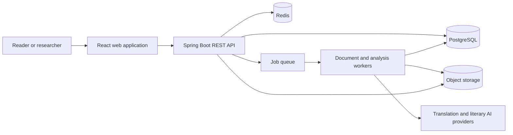
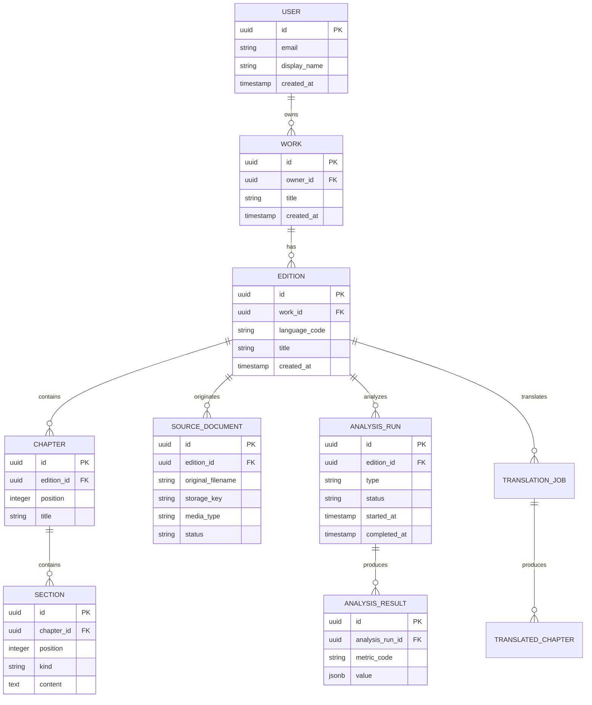
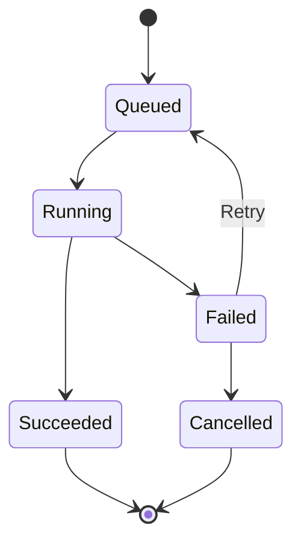
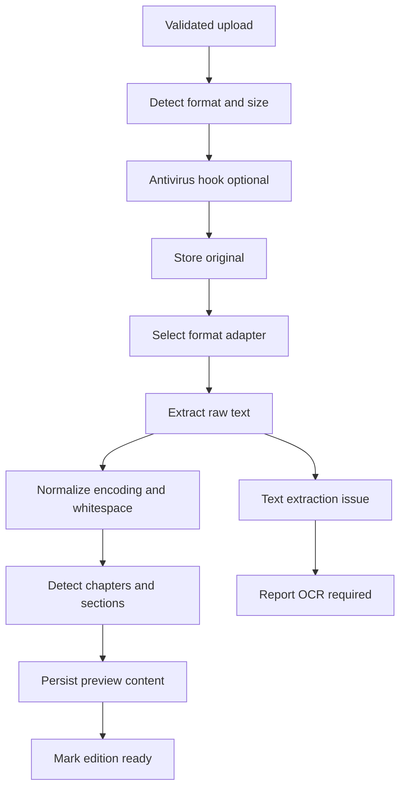

# BookLens Architecture

## 1. Architectural goals

The MVP must support:

- TXT, PDF and DOCX import.
- Portuguese, English and Spanish.
- Extraction, chapter detection and preview before analysis.
- Statistical, literary and comparative analysis.
- Complete translation with later export.
- New document formats and languages without changing core domain contracts.
- Replacement of AI services without changing deterministic analysis features.
- Long-running jobs with visible progress and recoverable failures.

## 2. System context



The React application handles navigation and presentation. Spring Boot owns authentication, orchestration and domain invariants. Workers process expensive operations asynchronously.

## 3. Monorepo structure

```text
booklens/
├── backend/
│   └── src/
│       ├── main/
│       │   ├── java/com/booklens/
│       │   │   ├── api/
│       │   │   ├── importcontent/
│       │   │   ├── analysis/
│       │   │   ├── translation/
│       │   │   ├── comparison/
│       │   │   ├── library/
│       │   │   ├── shared/
│       │   │   └── BookLensApplication.java
│       │   └── resources/
│       └── test/
├── frontend/
│   ├── src/
│   │   ├── app/
│   │   ├── features/
│   │   ├── components/
│   │   ├── services/
│   │   └── types/
│   └── public/
├── docs/
├── docker/
└── docker-compose.yml
```

## 4. Backend modules

### `api`

REST controllers, exception mapping, request/response DTOs and OpenAPI documentation.

### `importcontent`

Owns upload validation, text extraction and document normalization.

Initial responsibilities:

- TXT text decoding and line ending normalization.
- PDF selectable-text extraction.
- DOCX paragraph, heading and basic formatting extraction.
- Chapter and section detection.
- Detection of PDFs with no extractable text.
- Preservation of paragraphs and document metadata.
- Creation of import jobs and job progress events.

DOC and EPUB support must be implemented behind format adapters.

### `analysis`

Owns deterministic text metrics and literary analysis orchestration.

Examples:

- Word, character and sentence counts.
- Readability indicators.
- Vocabulary size and frequency.
- Chapter and paragraph statistics.
- Named entity and sentiment analysis when providers are available.

Deterministic algorithms must not depend on an AI provider.

### `translation`

Owns whole-book translation, provider adapters and translated document assembly.
The LibreTranslate adapter sends extracted text to the configured local service in ordered, size-limited chunks
and persists the complete translated text before enabling export.

### `comparison`

Compares normalized analysis results for editions of the same work in two or more languages.

### `library`

Owns works, editions, chapters, documents and user library relationships.

### `shared`

Cross-cutting domain identifiers, pagination, errors, storage abstractions and language definitions.

## 5. Core domain model



Language codes follow ISO 639-1: `pt`, `en` and `es`. Runtime-supported languages are registry entries, not hard-coded branches.

## 6. Processing model

Synchronous API endpoints only validate requests and create jobs. Document extraction, analysis and translation run asynchronously.



Every job stores:

- `job_type`
- `status`
- `progress`
- `error_code`
- `error_message`
- `attempt_count`
- `input`
- `result`
- timestamps

The API exposes short polling endpoints and may add Server-Sent Events later.

## 7. API conventions

Use versioned REST resources under `/api/v1`.

Recommended MVP resources:

```text
POST   /api/v1/documents/import
GET    /api/v1/documents/{documentId}
GET    /api/v1/documents/{documentId}/preview
POST   /api/v1/works
GET    /api/v1/works
GET    /api/v1/works/{workId}
POST   /api/v1/editions
POST   /api/v1/editions/{editionId}/analyses
GET    /api/v1/analyses/{analysisId}
POST   /api/v1/translations
GET    /api/v1/translations/{translationId}
POST   /api/v1/comparisons
```

Use DTOs for all requests and responses. Never expose JPA entities directly.

Standard error shape:

```json
{
  "code": "DOCUMENT_EXTRACTION_FAILED",
  "message": "The document could not be extracted.",
  "details": [],
  "traceId": "..."
}
```

Use RFC 7807 problem details or an equivalent consistent representation.

## 8. Import pipeline



PDF extraction must distinguish:

- Selectable text successfully extracted.
- No usable text.
- Partial text requiring page-level review.
- Suspected columns or reading-order problems.

OCR is an optional future stage and must remain separate from the selectable-text adapter.

## 9. Frontend architecture

React features should be organized around user capabilities:

- `library`
- `import`
- `document-preview`
- `analysis`
- `translation`
- `comparison`

State is divided into:

- server state: React Query
- local UI state: component state
- cross-feature state: a small typed context or store
- authentication state: dedicated auth module

The frontend must consume generated or maintained OpenAPI types and must not duplicate backend business rules.

## 10. Storage

Development:

- PostgreSQL container.
- Redis container.
- Uploaded files in a local mounted volume.
- H2 file database when running without Docker.

Production:

- PostgreSQL managed service.
- Redis managed service.
- S3-compatible object storage.

Stored objects use the edition/document UUID and a server-generated storage key. Original filenames are never used as paths.

## 11. Security

Initial requirements:

- Authentication and authorization.
- User-scoped library and document access.
- Signed, short-lived upload/download URLs when object storage is used.
- File size and MIME/format allowlists.
- Server-side format verification.
- Quota and rate limits.
- Protection against path traversal and content-type spoofing.
- Audit logs for destructive operations and exports.
- Secrets supplied through environment variables or a secret manager.

## 12. Observability

The MVP should provide:

- structured logs;
- correlation IDs;
- health, liveness and readiness endpoints;
- metrics for imports, job duration, failures and analysis counts;
- job trace links between API and workers.

## 13. Deployment

Docker Compose will run PostgreSQL, Redis and the backend for local development. React may run as a separate development server.

Production may initially deploy backend and frontend separately or through a reverse proxy. Containers must remain stateless; durable state belongs in PostgreSQL and object storage.

## 14. Initial delivery sequence

1. Repository and local infrastructure.
2. Authentication and library skeleton.
3. TXT import and document preview.
4. PDF import.
5. DOCX import.
6. Deterministic statistics.
7. Job progress and retry behavior.
8. Comparison of editions.
9. LibreTranslate translation provider configuration.
10. Literary AI analysis.
11. Export.
12. EPUB and OCR.

No feature should require all later stages to be usable.
